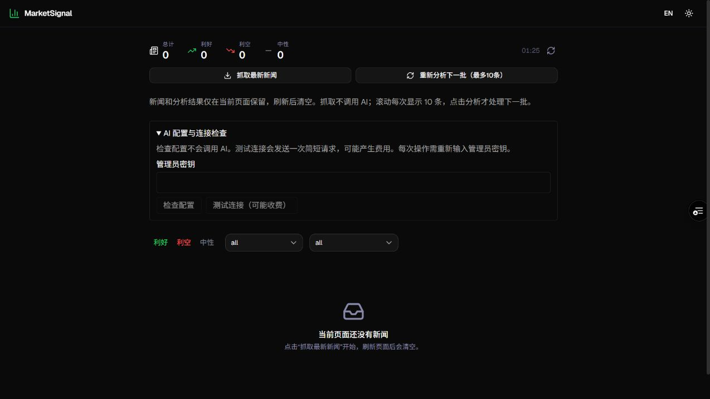

# MarketSignal

[简体中文](README.md) | **English**

MarketSignal fetches financial news on demand and can use DeepSeek or OpenAI to generate summaries, market sentiment, and affected-sector analysis. You can deploy your own instance.

**[Visit the website](https://marketsignal-sage.vercel.app/) · [Beginner deployment guide (Chinese)](DEPLOY_GUIDE.md)**

> The public website is the author's instance. Fetching and analysis require its administrator secret. For your own deployment, use your own secret and AI provider account.

## Features

- **On-demand news:** Fetch up to 200 items from enabled RSS feeds without calling AI.
- **AI analysis:** Analyze one article or up to 10 loaded articles at a time. Your chosen provider may charge for calls.
- **Browsing and filters:** Filter by sentiment, source, or sector; scroll to load items in batches.
- **Temporary session:** News and analysis are kept only on the current page and cleared on reload, closing the page, or a successful new fetch.

## Quick start

1. Fork this repository and import your copy into Vercel.
2. Set `ADMIN_SECRET`. For AI analysis, also configure `AI_PROVIDER`, `AI_API_KEY`, and `ENABLE_AI`.
3. Open your deployed site, enter the administrator secret to fetch news, and run analysis when needed.

The [beginner deployment guide](DEPLOY_GUIDE.md) is currently in Chinese and covers environment variables and troubleshooting. News can be fetched without an AI key; fetching and configuration checks still require the administrator secret.

**Please note:** AI analysis sends selected news content to your configured provider. Results may be inaccurate and are not investment advice. DeepSeek connection and single-item analysis have been tested on the production site. OpenAI has been simulated but not tested with a real key. Reuters is paused, and Yahoo covers S&P 500 news; feed availability may vary by network.

## How it works

| Action | Result | AI call |
| --- | --- | --- |
| Open or reload the page | Empty list and zero counts | No |
| Fetch news | Replace the current snapshot with up to 200 items from enabled feeds | No |
| Scroll, filter, or switch language | Show or filter items from the current snapshot, in batches of 10 | No |
| Analyze next batch | Analyze up to 10 loaded items not yet processed in this session, then stop | Yes |
| Analyze this article | Analyze only the selected article | Yes |
| Clear | Clear the current page's news and analysis | No |

- The frontend does not store news, analysis, or the administrator secret in localStorage, sessionStorage, or cookies. Language and theme preferences may be persisted.
- The current request flow does not read or write a database. Fetch and analysis responses use `Cache-Control: no-store`; each page has an independent snapshot.
- There is no background scheduled ingestion. Cron is no longer configured, and the old database-backed endpoints return HTTP 410.
- A failed fetch preserves the current snapshot. When only some sources fail, successful results and errors are shown together.
- Reloading discards paid analysis results; analyzing again may incur another charge. Failed items are not automatically retried. Requests already sent to the provider may still be charged after leaving the page.

## Local setup

1. Install Node.js 20.9 or later and run `npm ci`.
2. Copy `.env.example` to `.env.local` and set a server-side `ADMIN_SECRET`.
3. To enable analysis, set `ENABLE_AI=true`, choose `AI_PROVIDER=deepseek` or `openai`, and set `AI_API_KEY` to that provider's key. The legacy `OPENAI_API_KEY` is retained only for DeepSeek compatibility and is not used for the OpenAI provider.
4. Run `npm run dev` and open `http://localhost:3000`.

The current page flow does not require PostgreSQL. Prisma schema, migrations, and old pipelines remain for maintenance; do not run the old migrations, seed, or database analysis scripts to start session mode.

`ADMIN_SECRET` is for authentication and must not be placed in a `NEXT_PUBLIC_` variable. The page clears the input after each request. A shared secret is suitable for personal use; a public multi-user service needs account permissions and rate limiting.

## API

| Endpoint | Authentication and behavior |
| --- | --- |
| `POST /api/session/news` | `Authorization: Bearer <ADMIN_SECRET>`; fetches RSS and returns `items`, `fetchedAt`, and `errors`, without AI |
| `POST /api/session/analyze` | Same authentication; accepts `{items: [...]}` with 1–10 distinct complete news items and returns successful `items` and per-item `errors`, without database writes |
| Legacy `/api/news`, `/api/news/:id`, `/api/stats`, `/api/analyze`, `/api/reanalyze`, `/api/cron/ingest` | Disabled; return HTTP 410 |

Analysis input includes `id` (UUID), `title`, `link` (HTTP(S)), `source`, `publishedAt`, `contentSnippet`, and `ingestedAt`. The body limit is 32 KiB and each batch contains at most 10 items. Old requests containing only `newsIds` or a cursor are rejected. The server sets a 45-second deadline for a batch and starts no further items after cancellation or timeout.

## RSS feeds

- CNBC, MarketWatch, Bloomberg, Yahoo Finance, and Investing.com are enabled.
- Yahoo uses the official `^GSPC` (S&P 500) news feed, not all Yahoo Finance news.
- The old Reuters Agency RSS returned 404 and is paused; a working free official replacement has not been confirmed.
- `npx tsx scripts/check-feeds.ts` checks feeds without database writes or AI calls. It exits nonzero if an enabled source fails. A local result cannot substitute for testing from Vercel, since networks and regions can produce different errors.

## Diagnostics and checks

Search Vercel Runtime Logs for `[AI] Analysis diagnostic`. Logs contain allowlisted metadata such as finish reason, token counts, and field limits, not model text, raw errors, or keys. `OUTPUT_ACCEPTED` means the output passed validation; results are returned to the page, not stored in a database.

DeepSeek uses non-thinking mode (`reasoning_effort=none`). Both providers use JSON Output with a 1024-token limit. Summaries must be 10–500 characters and sectors limited to 1–3. Truncated output, invalid JSON, and invalid fields are reported separately without automatic paid retries.

Run `npm test`, `npx tsc --noEmit`, `npm run lint`, and `npm run build`. Browser checks should cover an initially empty page, fetching without AI, batches of 10, filtering, reload clearing, failed-fetch preservation, and rejection of unauthorized requests. RSS and AI still require network access.

## Removing legacy database records

Stopping database use does not automatically delete old data. Only after the new version is in production and the owner has explicitly confirmed deletion, verify the target Supabase project and table and run `scripts/purge-historical-news.sql` separately. It permanently deletes all news and analysis in `public."NewsItem"` while retaining the table structure; it does not change accounts or other tables.

Page reloads, preview builds, and deployment scripts do not execute that deletion script. Record the cleanup and its result separately. Deleted records will not return if you roll back to the old persistent version.
