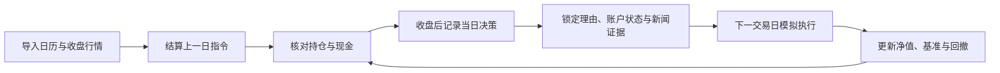

# MarketSignal

财经新闻监控、AI 分析与模拟投资实验。现有新闻看板保留，新增 `/paper` 实验区，将每日判断、证据、模拟成交、持仓与绩效串联起来。

## 功能

| 模块     | 内容                                                                                      |
| -------- | ----------------------------------------------------------------------------------------- |
| 新闻看板 | RSS 抓取、过滤、去重、情绪与板块筛选、新闻详情。                                          |
| AI 分析  | OpenAI `gpt-4.1-mini`；保留真实新闻发布时间、成功/失败/关闭状态及模型和 Prompt 版本。     |
| 每日决策 | 收盘后人工填写；冻结当时账户状态与引用新闻/分析副本，不能补写或覆盖历史决策。             |
| 模拟账本 | 单个人民币账户，白名单内沪深主板 A 股，下一交易日收盘价模拟成交，记录数量、价格及费用。   |
| 行情数据 | CSV 导入独立交易日历、标的未复权收盘价和沪深 300 价格指数点位；预检、重复导入与修订留痕。 |
| 绩效     | 每交易日现金、持仓和总资产，累计收益、沪深 300 同期对比、超额收益和最大回撤。             |
| 数据保护 | 服务端登录、HttpOnly 会话、写入来源检查、事务锁及幂等、完整 JSON 导出和估值版本保留。     |

## 快速开始

使用 Node.js 22+ 与 PostgreSQL。数据库连接与访问凭据配置在服务端环境，不提交到仓库。

```text
npm ci
npx prisma generate
npm run paper:credentials
```

按 `.env.example` 配置环境变量，然后依照[模拟投资指南](docs/PAPER_EXPERIMENT.md)选择**空库迁移或现有数据库基线接管**。完成后：

```text
npm run dev
```

打开新闻看板 `/` 或模拟投资实验 `/paper`。AI 是可选功能；未配置时新闻仍可抓取，但不伪造分析成功。新闻抓取与重新分析按钮也使用实验区的管理员登录会话。

## 本地合成演示

```text
npm run preview:paper
```

自动启动独立临时 PostgreSQL 和本地页面，使用明确标记的合成数据；口令仅显示在终端，不写入仓库。退出后演示数据不保留。这个模式用于体验和验证，真实实验需要持久数据库与核实行情。

## 实验流程



第一版不自动产生 AI 交易、不接真实券商，不支持多账户或出入金。停牌/涨跌停按保守规则不成交；缺日历或行情时暂停并说明原因。基准采用 `000300` 价格指数，不含股息再投资。详细限制、费用、公司行为、CSV 格式和恢复方式见[使用与维护指南](docs/PAPER_EXPERIMENT.md)。

## 技术与验证

Next.js 16 App Router、React 19、TypeScript、Tailwind CSS、Prisma 6、PostgreSQL。构建不自动改变数据库。

```text
npm test
npm run typecheck
npm run lint
npm run test:integration
npm run build
npm run test:http
```

集成与 HTTP 测试使用独立临时数据库，不连接生产环境。仓库 CI 执行上述检查。

## 接口入口

| 路径                                          | 说明                                           |
| --------------------------------------------- | ---------------------------------------------- |
| `/api/news`、`/api/news/[id]`、`/api/stats`   | 公开新闻读取与数量统计。                       |
| `/api/cron/ingest`                            | GET 供服务端 Cron；POST 供登录操作者手工触发。 |
| `/api/analyze`、`/api/reset-analysis`         | 授权的新闻重新分析与重置；不影响决策证据副本。 |
| `/api/paper/session`                          | 登录与退出。                                   |
| `/api/paper/dashboard`                        | 受保护的账户、持仓、绩效及记录。               |
| `/api/paper/account`、`/api/paper/decisions`  | 建立账户、锁定当日决策。                       |
| `/api/paper/import`、`/api/paper/settle`      | 导入及预检 CSV、结算已收盘日期。               |
| `/api/paper/adjustments`、`/api/paper/export` | 核对后的分红/送转事件、完整 JSON 导出。        |
| `/api/cron/paper`                             | 仅服务端 Cron 密钥可触发的自动结算。           |

模拟结果取决于数据、费用与成交假设，不能代表现实交易可获得的收益。
