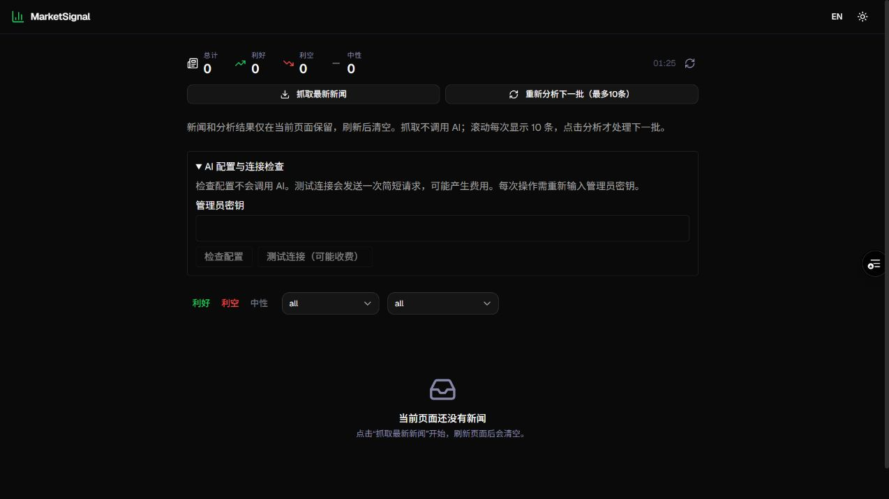

# MarketSignal

MarketSignal 是一个按需抓取财经新闻的工具，可使用 DeepSeek 或 OpenAI 生成摘要、市场情绪和影响板块分析，支持自行部署。

**[查看网站](https://marketsignal-sage.vercel.app/) · [新手部署指南](DEPLOY_GUIDE.md)**

> 在线网站是项目作者的部署实例。抓取和分析需要该实例的管理员密钥；自行部署后请使用自己的密钥和 AI 服务账户。

## 功能概览

- **按需抓取**：从已启用的 RSS 来源获取最新新闻，每次最多展示 200 条；抓取不调用 AI。
- **AI 分析**：支持单条分析，或对已加载新闻每次分析最多 10 条。分析会产生所选 AI 服务商的调用费用。
- **筛选与浏览**：按情绪、来源和板块筛选，滚动时逐批加载当前页面的新闻。
- **临时浏览**：新闻和分析结果仅保留在当前页面；刷新、关闭页面或成功重新抓取后清空。

下图为网站页面和 AI 配置检查入口。实际新闻和模型输出会随抓取内容及服务商变化。

## 快速开始

1. Fork 本仓库，并在 Vercel 中导入自己的副本。
2. 设置 `ADMIN_SECRET`；如需 AI 分析，再配置 `AI_PROVIDER`、`AI_API_KEY` 和 `ENABLE_AI`。
3. 部署后进入自己的网站，输入管理员密钥抓取新闻；按需点击分析。

详细操作、环境变量和常见问题见[新手部署指南](DEPLOY_GUIDE.md)。没有 AI Key 仍可抓取新闻；抓取与配置检查也需要管理员密钥。

**使用须知：** AI 分析会将所选新闻内容发送给你配置的服务商。结果可能有误，仅供参考，不构成投资建议。DeepSeek 已在本项目正式站完成连接和单条分析验证；OpenAI 已做模拟测试，真实调用尚未验证。Reuters 来源目前暂停，Yahoo 来源覆盖标普 500 相关新闻；各新闻源的可用性可能随网络变化。

## 当前行为

| 操作 | 结果 | AI 调用 |
| --- | --- | --- |
| 打开或刷新页面 | 空列表，统计归零 | 无 |
| 抓取最新新闻 | 从当前启用 RSS 生成最新快照，最多 200 条，替换本页旧结果 | 无 |
| 滚动、筛选、切换语言 | 在当前快照中每批展示 10 条或筛选 | 无 |
| 分析下一批 | 仅处理已加载且本次尚未处理的最多 10 条新闻，完成即停止 | 有 |
| 只分析这条 | 仅处理详情中的一条新闻 | 有 |
| 顶部清空按钮 | 清空当前页面新闻与分析 | 无 |

- 前端不把新闻、分析或管理员密钥写入 localStorage、sessionStorage 或 cookie。语言与主题偏好仍可持久保存。
- 新的请求链路不读取或写入数据库；抓取、分析响应均使用 `Cache-Control: no-store`。不同页面的新闻相互独立。
- 无后台定时采集：`vercel.json` 不再配置 Cron；旧新闻、统计、入库和数据库分析接口统一返回 410，旧页面也不能继续写库或调用模型。
- 重新抓取失败会保留本页现有快照，并提示错误；成功后替换，不跨会话积累。部分来源失败仍显示成功来源的新闻与错误。
- 刷新会丢失已付费分析结果，重新分析需要再次付费。单条失败不自动重试；离开页面后已发出的模型调用可能仍计费。

## 本地运行与配置

1. Node.js 20.9 或以上，执行 `npm ci`。
2. 从 `.env.example` 复制为 `.env.local`，配置独立的服务端 `ADMIN_SECRET`。
3. 抓取无需模型密钥；需要分析时设置 `ENABLE_AI=true`、`AI_PROVIDER` 为 `deepseek` 或 `openai`，并将该服务商密钥填入 `AI_API_KEY`。旧部署的 `OPENAI_API_KEY` 仅用于兼容 DeepSeek，不能被 OpenAI 服务商读取。
4. 执行 `npm run dev`，打开 `http://localhost:3000`。

当前页面流程无需 PostgreSQL。仓库保留 Prisma schema、历史迁移与旧管线代码作为维护资料，但应用入口已不再调用它们；不要运行旧迁移、seed 或数据库分析脚本来启动临时模式。

`ADMIN_SECRET` 仅用于鉴权，不能放进 `NEXT_PUBLIC_` 变量。页面每次操作输入密钥，提交后清空输入，不保存到浏览器。共享密钥适合个人使用；对外多用户服务仍应另行配置账户权限和请求频率限制。

## API

| 接口 | 鉴权和行为 |
| --- | --- |
| `POST /api/session/news` | `Authorization: Bearer <ADMIN_SECRET>`；只抓取 RSS，返回 `items/fetchedAt/errors`，不调用 AI |
| `POST /api/session/analyze` | 同上；提交 `{items: [...]}`，包含 1–10 条不同的完整新闻输入；返回成功 `items` 和逐条 `errors`，不写库 |
| 旧 `/api/news`、`/api/news/:id`、`/api/stats`、`/api/analyze`、`/api/reanalyze`、`/api/cron/ingest` | 已停用，返回 410；客户端需刷新后使用临时流程 |

分析输入含 `id`（UUID）、`title`、`link`（HTTP(S)）、`source`、`publishedAt`、`contentSnippet`、`ingestedAt`。正文限 32 KiB，每批最多 10 条；旧版只传 `newsIds` 或 cursor 的请求被拒绝。服务器为整批设置 45 秒截止时间，已取消或超时后不再启动后续条目。

## RSS 来源

- 启用 CNBC、MarketWatch、Bloomberg、Yahoo Finance、Investing.com，共 5 个来源。
- Yahoo 使用官方 `^GSPC`（标普 500）相关新闻 RSS，不代表全部 Yahoo 财经新闻。
- Reuters Agency 旧 RSS 返回 404，已暂停，尚未确认可用的官方免费替代入口；不把其他媒体标成 Reuters。
- `npx tsx scripts/check-feeds.ts` 只检查 RSS，不写库、不调用 AI；任一启用来源失败即返回非零退出码。不同网络和地区可能返回 403 或超时，本地结果不能替代 Vercel 实测。

## 分析失败与检查

Vercel Runtime Logs 中搜索 `[AI] Analysis diagnostic`。日志只记录白名单元数据，包括结束原因、Token 数和字段上限，不记录模型正文、原始错误或密钥。`OUTPUT_ACCEPTED` 表示输出通过校验；当前结果返回给页面，不会写入数据库。

DeepSeek 使用非思考模式（`reasoning_effort=none`）；两个服务商均使用 JSON Output、1024 Tokens 上限。摘要 10–500 字符，板块 1–3 个。截断、损坏 JSON 和字段不合格分别提示，不自动重复收费请求。

执行 `npm test`、`npx tsc --noEmit`、`npm run lint` 和 `npm run build`。浏览器还需验证：初始为空、抓取不分析、10 条分页、筛选不丢失本页快照、刷新归零、失败保留现有结果、未授权请求被拒绝。当前页面不依赖数据库，但 RSS 与模型仍需网络。

## 清理旧数据库记录

停止使用数据库不会自动删除原先的历史记录。应在新版本生产发布成功后，确认目标 Supabase 项目及表，在用户明确确认清理后单独运行 `scripts/purge-historical-news.sql`；它永久删除 `public."NewsItem"` 内的全部新闻与分析，保留表结构，不修改账户或其他表。

**刷新页面、预览构建和部署脚本均不会执行这个删除文件。** 清理执行与结果需单独记录；历史记录清理前不要宣称数据库已清空。若回滚到旧持久化版本，已经删除的数据不会恢复。
